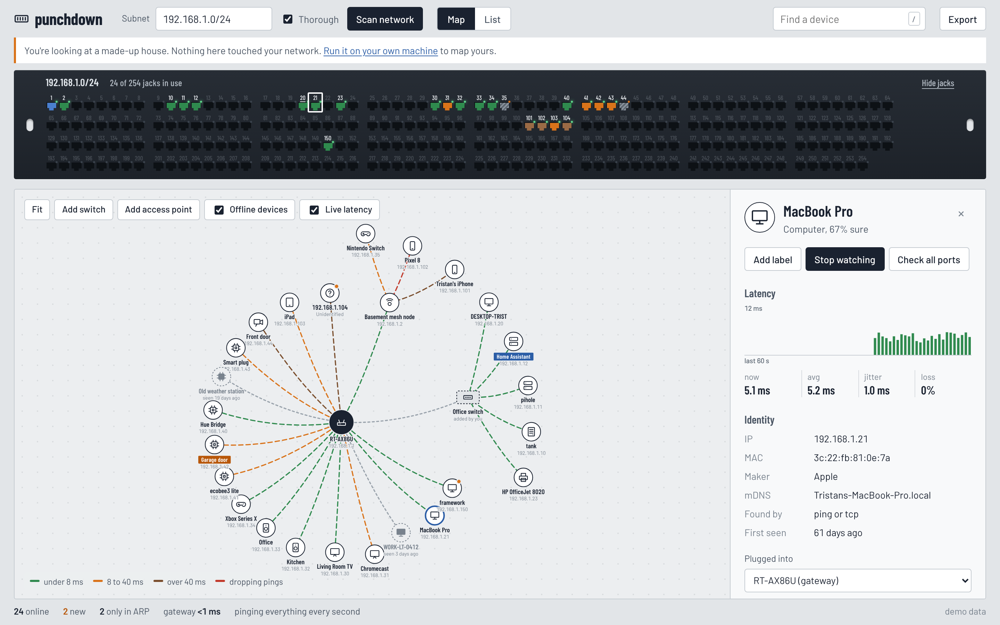

# punchdown

Made by Tristan Edwards ([TristEdw](https://github.com/tristedw))

A map of everything plugged into your home network, in a browser tab, that
never talks to anything outside your house.



Demo with a fake house: https://tristedw.github.io/punchdown/

Most router client lists are a column of MAC addresses and "unknown". The phone
apps want an account and a lot of the desktop tools phone home. I wanted
something you start with one command, that needs no installs, keeps everything
on your machine, and tells you *why* it thinks a box is a printer.

## What it does

**Patch panel.** Across the top there's a jack for every address in the subnet.
As the sweep runs they plug in one by one, coloured by how fast the device
answered. Click a lit jack to jump to the device. Striped jacks are the quiet
ones that ignored every probe and only showed up in the ARP table.

**Map.** A radial view with your router in the middle. Devices are grouped by
kind around it and the cables are coloured like a T568B pair: green is quick,
orange is noticeable, brown is slow, red is dropping packets. Drag things where
you want them and they stay put.

**Your own wiring.** A scan can't see an unmanaged switch or a dumb access
point because they don't have IPs. You can add them yourself and tell each
device what it's plugged into, so the map matches the closet.

**Device identification.** Every device gets a guess and a confidence, built
from a vote across a few signals:

* MAC vendor from a bundled copy of the IEEE OUI registry (40k prefixes, works offline)
* names from unicast mDNS, NetBIOS, and a PTR lookup sent to your router
* UPnP descriptions found with one SSDP shout on the local multicast group
* the `<title>` of any admin page it serves
* which of ~40 telling ports are open (9100 means printer, 62078 means iPhone, 1400 means Sonos...)
* whether it uses a private randomized MAC, which is almost always a phone

The details panel lists the reasons, so when it's wrong you can see why.

**Latency.** Watch one device or turn on live latency for everything. It pings
once a second, keeps a minute of history, and shows avg, jitter and loss. If a
device ignores ICMP it times a TCP handshake on a port it's known to answer on
instead. Phones that drop ping while asleep still show up.

**Memory.** Labels, positions and first-seen dates are kept in
`~/.punchdown/state.json`, so the next scan can tell you what's new and what
dropped off.
Turn on "Offline devices" to see things that were here before but aren't now.

**Other bits.** Full 1-1024 port check per device, Wake on LAN, a sortable list
view, search (`/`), and export to JSON, CSV or an SVG of the map.

## Running it

Needs Python 3.10 or newer. No packages.

```bash
git clone https://github.com/tristedw/punchdown
cd punchdown
python3 -m punchdown
```

That opens a tab at `127.0.0.1:8737`. Pick a subnet (it guesses yours) and hit
**Scan network**. A /24 takes 10 to 25 seconds depending on how many addresses
are empty, since dead addresses have to time out.

```
python3 -m punchdown --port 9000      # different port
python3 -m punchdown --no-browser     # just print the link
```

Works on Linux, macOS and Windows. No root needed. ICMP goes through the system
`ping` binary, everything else is plain sockets.

Keyboard: `s` scan, `/` search, `m` map, `l` list, `f` fit, `[` and `]` step
through devices, `w` watch the selected one, `Esc` to close.

## Privacy and security

This was the part I cared about most, since a network scanner is exactly the
kind of thing you don't want leaking.

* **Nothing goes to the internet.** No CDN, no fonts from Google, no analytics,
  no update check. Every probe goes to an address inside the private range
  you're scanning, or to the local multicast groups (SSDP, mDNS) which are
  link-local and sent with TTL 1.
* **Private ranges only.** The server refuses to scan or ping anything that
  isn't 10/8, 172.16/12 or 192.168/16, and caps a scan at a /22. You can't
  point it at someone else's network.
* **Reverse DNS goes to your router, not your resolver.** If your machine uses
  8.8.8.8 or DoH, a normal PTR lookup for `192.168.1.23` would leave the house.
  punchdown builds the DNS packet itself and asks the gateway directly.
* **No proxies.** Python's urllib honours `HTTP_PROXY` by default, which would
  route LAN page fetches through someone's proxy. That's switched off.
* **Only you can drive it.** The server binds to `127.0.0.1` and nothing else.
  Each run mints a random token that the browser gets in the URL fragment
  (which never goes over the wire) and sends back as a header. Any other site
  you have open can't read it, so it can't make your browser start scans.
* **DNS rebinding blocked.** Requests with a `Host` header that isn't
  `127.0.0.1` or `localhost` get rejected, as do foreign `Origin` and
  cross-site `Sec-Fetch-Site` headers.
* **Strict CSP** of `default-src 'self'`, plus `nosniff`, `frame-ancestors
  'none'` and friends. No inline scripts or styles anywhere.
* **Local state is yours.** `~/.punchdown/state.json` is written with mode 600.
  Delete the folder and it forgets everything.

The tests in `tests/test_server.py` poke at all of the above the way a hostile
page would.

## Limits

Worth knowing before you trust the map completely.

The map is logical, not physical. An IP scan sees who's on the subnet, not which
switch port they're in, which is why you can add switches and APs by hand.

Some devices really are invisible. A phone with Wi-Fi asleep, a smart plug that
only talks to its cloud, anything on a guest network or a separate VLAN.
Running a scan twice a minute apart usually catches a couple more.

Device types are a best guess. A Raspberry Pi could be anything, and a TV that
blocks every port looks like "unidentified". The confidence number is honest
about that.

MAC addresses only show up for devices on the same subnet as the machine
running punchdown, because that's what ARP can see.

## How it's put together

```
punchdown/
  netinfo.py    interfaces, gateway and ARP table parsing per OS
  probes.py     ping, tcp connect, DNS/mDNS/NetBIOS packets, SSDP, http title, WoL
  identify.py   OUI lookup, port table, the scoring rules
  scanner.py    sweep, ARP pass, enrichment, event stream
  server.py     http server, token and host checks, JSON API
  store.py      ~/.punchdown/state.json
  data/         oui.tsv.gz
web/
  js/           vanilla ES modules, no build step
  css/ fonts/   Barlow, self hosted
tests/          python -m unittest discover -s tests
scripts/        build_oui.py regenerates the vendor table
```

Scan progress streams to the page as newline delimited JSON over a held-open
fetch, rather than EventSource, because EventSource can't send the auth header.

The map is a radial tree (each subtree gets a slice of the circle sized by its
leaf count) eased into place with a small collision pass, all hand rolled on
SVG. No d3, no framework, no bundler.

The hosted version runs the same frontend against a fake backend in
`web/js/demo.js`, so the page can't tell the difference.

To refresh the vendor table:

```bash
npm pack oui-data && tar xzf oui-data-*.tgz
python3 scripts/build_oui.py package/index.json
```

## Licence

MIT, see [LICENSE](./LICENSE). Barlow is under the SIL Open Font License, see
`web/fonts/OFL.txt`. OUI data is from the IEEE registry via the
[oui-data](https://www.npmjs.com/package/oui-data) package.

Only scan networks you own or have permission to scan.
